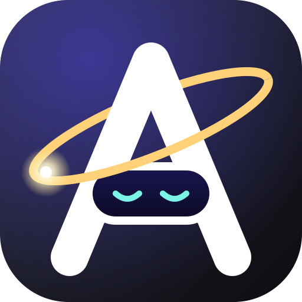

<p align="center">
  
</p>

<h1 align="center">Andromeda</h1>

<p align="center">A calm, glass desktop for Linux, with your phone built in.</p>

---

Andromeda is a complete Wayland desktop. The compositor, shell, apps and phone link are designed together, so every
surface follows one design and feels like one system.

> **Status:** early preview. Expect rough edges, and keep another desktop installed.

## Features

- Wayland compositor with a single-pass glass blur on panels, dock and bar (adjustable in Settings)
- Dynamic island at the top of the screen for clock, media, volume, notifications, calls and timers
- Universal search (Super key): apps, files, clipboard and emoji with inline previews
- Android phone integration: shared clipboard and files, notification replies, media control, calls, phone finder, screen mirroring
- Unified Settings app for displays, input, appearance, power, network, sound and users
- Bundled apps (Files, Player, Viewer) built on the same toolkit and design
- Power management: app freezing in power saver, focused-app priority, per-app battery usage

## Install

Andromeda supports Arch Linux, Ubuntu 26.04, Debian testing/sid and Kali (x86_64). Each release publishes signed packages
for all of them. Debian 13 (trixie) is not supported: it lacks libglycin-2.

Run this one command. It detects your system, adds the Andromeda repository and installs the desktop:

```sh
curl -fsSL https://github.com/Andromeda-Desktop/desktop/releases/latest/download/install.sh | bash
```

To read the script before you run it, download it with `curl -fsSLO` and run `bash install.sh`.

### After installing

Log out, choose **Andromeda** on the login screen, and log in. The first-run setup opens.

To update, run `sudo pacman -Syu` on Arch or `sudo apt update && sudo apt upgrade` on Ubuntu, Debian and Kali.

Optional: `andromeda-power-git` (Arch) or `andromeda-power` (Ubuntu, Debian, Kali) turns on extra laptop power saving (PCIe ASPM, USB autosuspend). It changes kernel
defaults and can upset some USB devices, so it is not installed by default.

## Build from source

```sh
git clone --recursive https://github.com/Andromeda-Desktop/desktop.git
cd andromeda
just build
just dev-nested   # opens a test desktop in a window
```

`just package` builds the Arch packages into `pkg/`. `tools/ubuntu-deb.sh` builds the Ubuntu packages in a container (`tools/ubuntu-deb.sh testing` for Debian).

## Phone app

Download `andromeda-link.apk` from the [latest release](https://github.com/Andromeda-Desktop/desktop/releases/latest) and
install it on your phone (Android 10 or later). Open the control center, go to Devices, press Pair, and scan the code. The app is not on Google Play, because it needs clipboard, storage and accessibility access
that Play does not allow.

## Contributing

Run `just --list` to see every build, test and dev command.

## License

GPL-3.0-or-later. See [LICENSE](LICENSE) and [NOTICE](NOTICE). Releases up to and including v0.2.8 are MIT.

Andromeda began as a fork of the [Noctalia](https://github.com/noctalia-dev) projects (MIT). Their copyright notices
stay in the `LICENSE` file of each forked directory: `compositor/`, `shell/`, `greeter/` and `portal/`.

Contributions need a signed [Contributor License Agreement](CLA.md): sign it with one comment on your first pull request.
